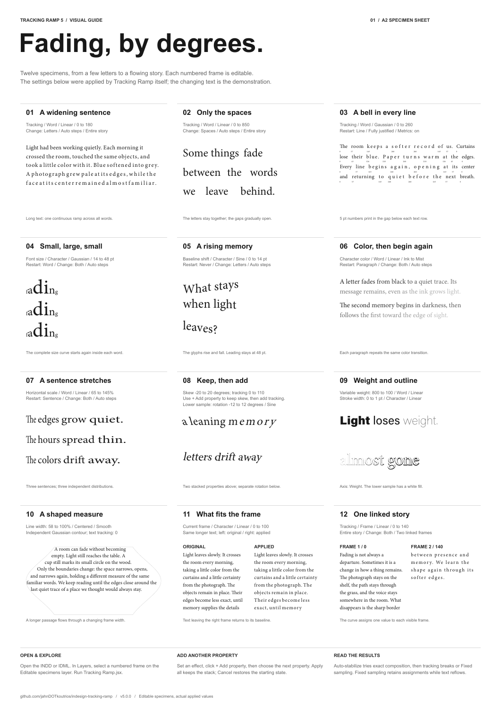
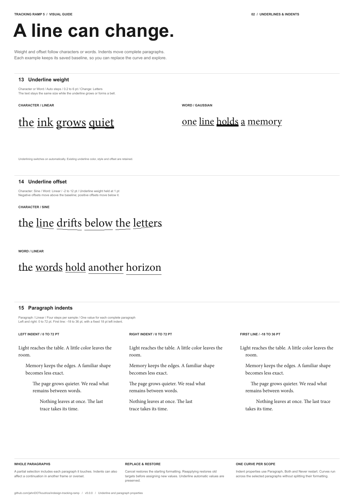
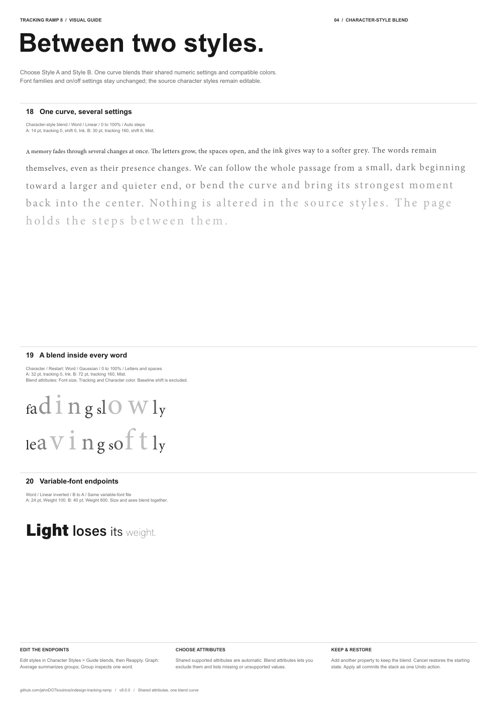
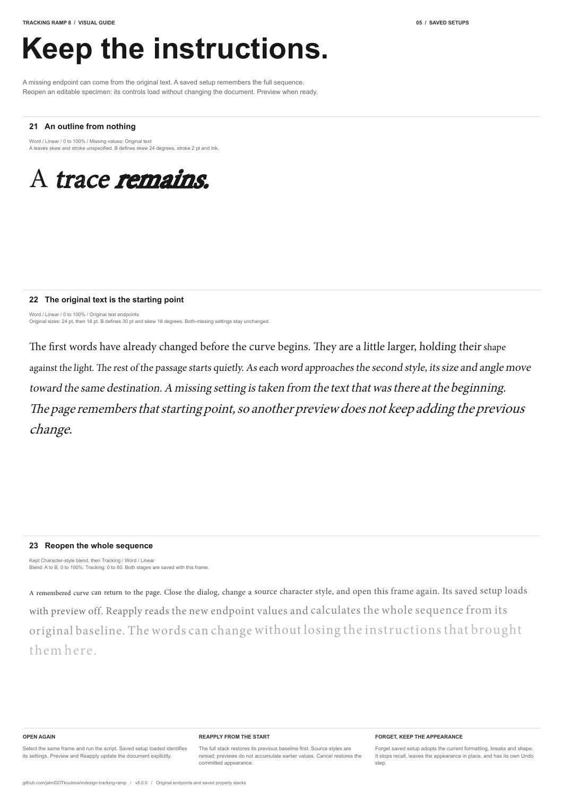
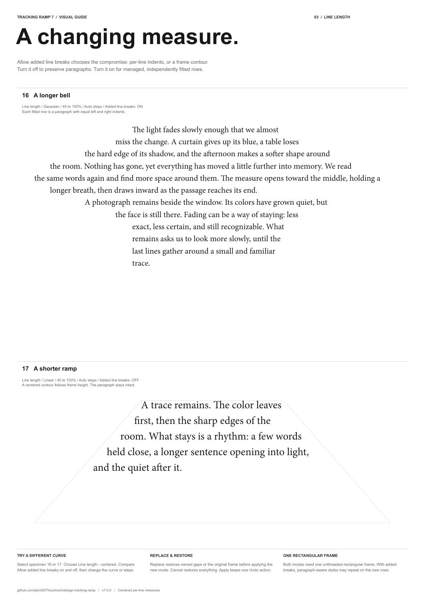

# Tracking Ramp

**Text distribution for Adobe InDesign — v8.0.0**

Apply tracking and other text properties along a curve, then repeat that curve
inside words, sentences, paragraphs, composed lines, or linked frames.
A standalone ExtendScript `.jsx` with a ScriptUI interface; no plugin build or
runtime dependencies are needed in InDesign.

## Visual guide

A minimal, five-page A2 visual guide with short and long fading-themed text,
23 labeled examples, and 31 named editable specimen frames. The second page
covers underline weight, underline offset, and paragraph indents. The third
page adds long and short Line length specimens; the fourth demonstrates
character-style blends with editable endpoint styles. The fifth adds original-text
endpoints and saved property stacks.

[View the PDF](docs/visual-guide/Tracking%20Ramp%20-%20Visual%20Guide.pdf) ·
[Download INDD](docs/visual-guide/Tracking%20Ramp%20-%20Visual%20Guide.indd) ·
[Download IDML](docs/visual-guide/Tracking%20Ramp%20-%20Visual%20Guide.idml) ·
[Explore the examples](docs/visual-guide/README.md)

[](docs/visual-guide/Tracking%20Ramp%20-%20Visual%20Guide.pdf)

<details>
<summary>Underlines and paragraph indents</summary>



</details>

## Install and run

1. Download [Tracking Ramp.jsx](https://raw.githubusercontent.com/jahnDOTkoutrios/indesign-tracking-ramp/main/Tracking%20Ramp.jsx), or clone this repository.
2. In InDesign, open **Window → Utilities → Scripts**.
3. Right-click the **User** folder and choose **Reveal in Finder** / **Reveal in Explorer**. Copy `Tracking Ramp.jsx` into the Scripts Panel folder revealed there.
4. Select a text frame, highlight text, or place the text cursor inside a frame. Double-click **Tracking Ramp.jsx** in the Scripts panel.

Tested in **Adobe InDesign 2026 on macOS**. This is an ExtendScript `.jsx` script,
not a UXP `.idjs` plugin. Other InDesign versions and Windows are unverified.

## Choose the structure

| Control | Purpose | Choices |
| --- | --- | --- |
| Scope | Which text participates | Highlighted text, current frame, entire linked story |
| Values per | What receives one value | Character, word, sentence, paragraph, line, frame |
| Restart curve per | Where the complete curve starts again | Never, word, sentence, paragraph, line, frame |
| Every … words | With Restart → Word, restart after this many words | 1–10000; default 1 |
| Graph | Average across restart groups, or inspect one group | Display only; document values stay unchanged |

**Min/Max, steps, and the curve are shared by all groups.** Each group receives
its own complete sampled distribution. To keep one continuous curve across
the scope, set **Restart → Never**.

Examples:

- **Font size → Character → restart per Word → Gaussian:** each word gets a small → large → small pattern.
- **Tracking → Word → Restart Word, Every 3 words:** repeat the curve across successive three-word groups. A shorter final group also receives the full curve.
- **Tracking → Word → restart per Sentence:** tracking rises and falls across each sentence.
- **Tracking → Character → restart per Line:** the full curve repeats in every resulting line.
- **Baseline shift → Line → restart per Frame:** each linked frame gets its own rise-and-fall pattern.

## Features

- **Properties:** tracking, font size, baseline shift, variable-font axes, horizontal/vertical scale, character rotation, skew, character fill color/tint, text stroke width/color/tint, underline weight/offset, left/right/first-line paragraph indents, centered per-line length, and Character-style blend.
- **Curves:** linear, ease in/out, S-curve, Gaussian, sine, triangle, and custom draggable control points with shifted or multiple peaks.
- **Steps:** automatic per-group sampling or a shared fixed step limit capped to each group's length.
- **Responsive input:** numeric previews wait for a 350 ms typing pause; Apply uses the latest value immediately. Sliders update the graph during dragging and the document on release. Custom-curve document previews remain throttled.
- **Saved setups:** reopen the owning frame to recover its full ordered setup. Preview starts off; Preview/Reapply updates explicitly. Forget saved setup keeps its current appearance with an independent Undo.
- **Live preview and stacking:** adjust one property, click **+ Add property**, choose the next property, and continue. A read-only Kept strip and Undo addition appear for stacks. Apply all commits one named Undo transaction; Cancel restores the whole session.
- **Allow added line breaks:** separate from Auto-stabilize and off by default for every property. Enable it to permit managed tracking soft breaks or per-line paragraph breaks for Line length.
- **Auto-stabilize composition:** starts with exact resulting composition, then uses **Fixed sampling** when needed. Managed tracking breaks are tried only with explicit permission. Min/Max are not rescaled.
- **Line length — centered:** with added breaks off, preserve paragraphs and use a centered frame contour from top to bottom. With breaks on, fit each row with equal left/right indents and managed paragraph breaks. Switching modes restores owned whitespace/geometry; Cancel and Undo restore the starting state.
- **Frame contour:** minimum/maximum available width in %, pt, or mm; left/center/right anchoring; smooth or stepped sides; linked or independent curve.
- **Metrics:** printable, visible 5 pt overlays show integer tracking values centered in the gap below each text row. Tight leading may cause overlap; source leading is preserved.
- **Reapplication:** restores the previous saved baseline for a property before recalculating it. A separate Clear tracking option supports older effects.

## Blend two character styles

Choose **Character-style blend**, then **Style A** and **Style B**. Min/Max
become blend percentages (0 = A, 100 = B). The existing curve, value units and
restart controls drive every included attribute together. **Blend attributes…**
lets you exclude attributes and explains unsupported or missing values.

Shared supported values are automatic, including inherited values. New UI
blends use **Missing values → Original text**: if only one style defines a value,
the other endpoint comes from the original text. **Skip** retains the v7 rule.
Both missing leaves the attribute untouched. Inferred attributes are labeled.

Numbers, compatible process colors and complete axes on a compatible variable
font can blend. A stroke can grow from zero when an endpoint defines its paint. Automatic
style endpoints, incompatible paints and discrete switches are skipped;
unsupported automatic original dimensions need explicit endpoints or Skip.
Source styles and assignments remain untouched. Intermediate results are local
formatting. Reapply rereads styles; kept values stay frozen within one session.

[](docs/visual-guide/Tracking%20Ramp%20-%20Visual%20Guide.pdf)

## Reopen a saved setup

Select its owning frame and run the script. **Saved setup loaded** restores the
properties, endpoint styles, included attributes, curve, steps, scope and restart
rules. A saved highlighted range becomes **Saved highlighted text** in Scope.
The document stays as it was until **Preview**, enabling Live preview, or
**Reapply / Reapply all**. Earlier kept stages are visible in the Kept strip;
**Undo addition** returns the last one to editing.

Reapply restores the previous stack baseline before running the current style
definitions in order. **Forget saved setup** keeps the appearance, adopts current
formatting/breaks/shape as the new baseline and stops recall. It is a separate
Undo action; Cancel after forgetting does not undo that explicit Forget action.

There is **one saved setup per linked story**, with one owning frame. Other
linked frames explain where it belongs; select that owner to reload it. Changed
text/history or a different highlighted selection is explained before replacing.
Deleted/renamed styles can be selected again in the controls. V8 recipes persist
in INDD and IDML. Earlier single-property controls can be recovered with preview
off and an **Earlier setup loaded — review scope** note. Earlier stack order
is unavailable; complete ordered recall starts with a setup applied in v8.
Recovered blends retain **Skip** until you choose **Original text**.

[](docs/visual-guide/Tracking%20Ramp%20-%20Visual%20Guide.pdf)

## Preview performance

Native InDesign 2026 measurements on the same 500-word / 2,672-character
fixture, comparing v7 with a development v8 build:

| Preview | v7 | v8 |
| --- | ---: | ---: |
| Three numeric blend attributes, Word | 0.821 s | 0.580 s |
| Numeric + color blend, Word | 1.313 s | 0.735 s |
| 21 blend attributes, Word | 3.999 s | 1.077 s |
| Size + variable axes, Word | 33.962 s | 5.167 s |
| Size + variable axes, Character | 37.540 s | 27.180 s |

The first two rows are medians of three changed previews; the remaining rows
are single runs. All seven measured scenarios matched v7 text, units, sampled
values and per-character formatting. Character-level variable-font changes
remain expensive. These are local measurements, not timing guarantees. See
[performance notes](docs/PERFORMANCE.md) for all scenarios and safeguards.

<details>
<summary>Line length examples</summary>



</details>

## Important behavior

- New drafts affect letters and internal spaces together. In Word mode the following gap receives its preceding word’s percentage. Earlier Letters/Spaces recipes remain readable by the engine; reopening the active draft uses Both.
- Units crossing a restart boundary are split into disjoint fragments. Groups with one unit receive the curve's starting value; a bell needs at least three sampled stages to show an interior peak.
- Sentence detection uses punctuation and common abbreviation/decimal handling. It is a heuristic; review ambiguous text.
- For character properties, Current frame scope continually resamples the final visible text. Text leaving the frame returns to its baseline; newly fitting text joins the distribution. Line/frame structures exclude overset. Semantic units can include overset in entire-story scope.
- **Auto-stabilize composition** is on by default; **Allow added line breaks** is off. With added breaks enabled, Tracking can insert real soft line breaks at word gaps using a conservative Max-tracking layout. Reapply replaces managed breaks; Cancel restores the text. If fixed sampling is needed, final lines/frames may differ from the sampled groups. Outgoing frame text returns to its baseline; newly fitting text may retain its baseline. Disable Auto-stabilize for strict convergence.
- Each property can appear once per stack. Kept values are frozen within the current session; reopening recomputes the saved sequence from its baseline. Undo addition returns the last kept effect to editing and discards the current draft. A kept contour remains fixed while adding further properties. After manual edits to a saved setup, Forget adopts the current text and managed breaks as the new baseline.
- Underline properties enable underlining on eligible targets and preserve original automatic values for replacement/Cancel.
- Indents use whole intersecting paragraphs, including any continuation beyond the selected scope. Values per is Paragraph and Restart is Never; previous structure choices return when selecting another property.
- Line length uses Current frame / Line / Both / Never. It requires one unthreaded rectangular frame with one ordinary column, equal insets, auto-sizing off and no frame transform. Automatic lists/drop caps are excluded. With added breaks on, it changes paragraph structure and paragraph-aware styles may repeat. With them off, the width curve follows frame height, so short text may use only part of it. Existing paragraph indents remain in the no-break mode.
- Frame contour shapes only the selected frame. It requires one ordinary column, equal insets, auto-sizing off, and an unrotated/unsheared frame at 100% scale.
- Baseline shift does not increase leading. Large scale, skew, rotation, or shift values can overlap text or extend beyond a frame.
- Multiple-frame selection, table cells, notes, text on paths, and grouped-frame selection are not supported.

See the [full user guide](docs/USER-GUIDE.txt) for property ranges, curve editing,
metrics, frame shaping, replacement behavior, and composition limits.

## Development and verification

Run the dependency-free regression suite with Node.js:

```sh
node tests/tracking-ramp.test.cjs
```

The suite was tested with Node.js v24.21.0 and passes **162 checks**. It evaluates
the actual script's functions using document and ScriptUI mocks; it does not
launch InDesign. An optional `TRACKING_RAMP_SOURCE` environment variable can
point it at another script file.

V8 passed **294 native assertions in InDesign 2026 on macOS**: 62 blend/setup
checks, 30 actual UI checks, 93 exported-IDML checks, 14 recalled-layout checks
and 95 repeated line-length/break-policy checks. Earlier coverage is recorded separately in the
[verification notes](docs/VERIFICATION.md). All five guide pages were rendered
and visually checked.

[Version notes](CHANGELOG.md)

## v8 refinements

The dialog separates Property, Distribution, Composition and Curve settings.
One **Preview** checkbox at the bottom controls document preview. Saved setups
still open with it off. New drafts always affect both letters and internal spaces.

**Graph: Average** shows an equally weighted average of the actual samples in
each restart group, aligned at normalized positions. **Graph: Group** inspects
one group. This changes only the graph, not the applied curve or word values.
With Values per Word, one percentage applies to each word and its following gap;
mixed original formatting can still produce different inferred values within it.

Generated process colors use readable endpoint names and a **Tracking Ramp**
swatch group. Equivalent generated channel values are reused. Original endpoints
stay in their groups. **Colors…** can group older generated colors or remove only
unused generated colors; saved baseline references are protected. These explicit
maintenance actions have a separate Undo step and persist if the text dialog is
cancelled. Same-base process-color tints blend through character tint, creating
no intermediate swatches. Tint endpoints with different base colors are unsupported.

A paint-only style blend cannot activate a hidden stroke width on text whose
original stroke paint was None. Explicit widths, including inherited widths,
still blend. Removed attributes and previous style choices restore their baseline.
Undoing a text edit restores saved-setup eligibility when the original text/range
is restored; simply opening the dialog does not delete stale setup metadata.

The main Property, Scope, Values per, Restart and Curve dropdowns use equal
widths and aligned captions. Entries are concise (Frame, Story, Line, Custom);
composition and scope explanations are available as tooltips.

Stroke blending treats None as a real no-stroke endpoint. A missing width
behind original None paint resolves to visible zero. When both endpoints omit
stroke paint, the original paint is left unchanged; stored width values alone
never borrow the fill color. Zero endpoints remain None. Explicit None in both
styles keeps stroke off, even if the styles store nonzero widths.
Paint-only blends preserve original None paint and its hidden stored width.
