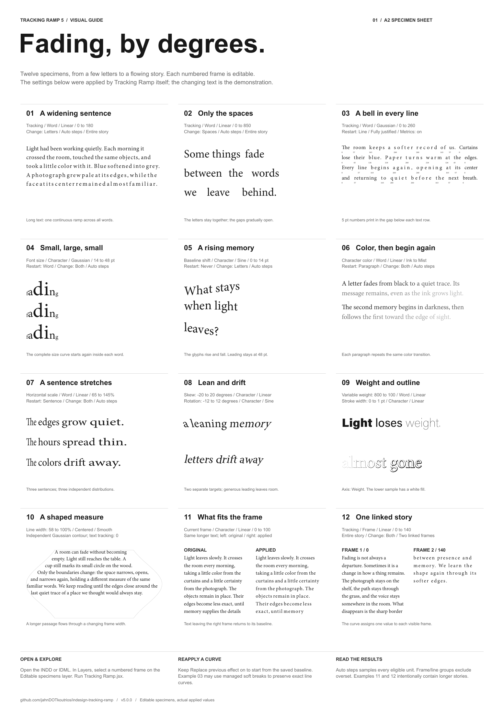

# Fading, by degrees.

One A2 page, twelve examples. The effects were applied in InDesign 2026 by the
actual Tracking Ramp v5 engine. Labels stay neutral so the text does the work.

[PDF](Tracking%20Ramp%20-%20Visual%20Guide.pdf) ·
[Editable INDD](Tracking%20Ramp%20-%20Visual%20Guide.indd) ·
[Interchange IDML](Tracking%20Ramp%20-%20Visual%20Guide.idml)

## Try it

Open the INDD or IDML. Expand **02 - Editable numbered specimens** in Layers.
Select a frame named **01…12 - … - EDIT ME**, then run `Tracking Ramp.jsx`.
Use the printed caption to recreate its settings. Keep **Replace previous effect**
on to replace the saved effect without stacking values. Labels and rules are
on separate locked layers; metrics are on their own printable layer.

| No. | Example | Applied settings |
| --- | --- | --- |
| 01 | Longer text, tracking | Word; Linear; 0–180; Letters |
| 02 | Spaces only | Word; Linear; 0–850; Spaces |
| 03 | Justified line bells | Word; restart Line; Gaussian; 0–260; 5 pt metrics |
| 04 | Font-size bells | Character; restart Word; Gaussian; 14–48 pt |
| 05 | Baseline wave | Character; Sine; 0–14 pt; fixed 48 pt leading |
| 06 | Color reset | Word; restart Paragraph; Linear; Ink to Mist |
| 07 | Horizontal scale | Word; restart Sentence; Linear; 65–145% |
| 08 | Skew and rotation | Character; Skew −20–20° Linear; Rotation −12–12° Sine |
| 09 | Weight and stroke | Word; variable Weight 800–100; Character stroke 0–1 pt |
| 10 | Frame contour | Centered, smooth; width 58–100%; independent Gaussian, bell width 29% |
| 11 | Live frame scope | Original vs Character tracking 0–100; Linear |
| 12 | Linked story | Frame; Linear; 0–140; Both; Entire story |

All examples use Auto steps. Unless a caption specifies a restart group, the
curve runs once across the local scope. Semantic samples use Entire story;
03 and 11 use Current frame, and 12 uses Entire story across linked frames. Example 10 changes only frame width;
its faint contour is a guide rule. Example 11 intentionally has overset text:
the applied frame shows 213 characters versus 234 in the control, and outgoing
overset retains tracking 0. Example 12 is one continuous story in two frames.
Metrics remain tracking values even when another property is selected.

## Files and fonts

The INDD and IDML contain 16 uniquely named specimen frames with saved effect
history. The PDF is one 420 × 594 mm page with live, selectable text. Arial,
Minion Pro, and Acumin Variable Concept were used; font files are not bundled.
Activate or substitute missing fonts before editing; substitution can reflow text.

[Build Visual Guide.jsx](Build%20Visual%20Guide.jsx) regenerates the page with the
current repository engine. Keep it in this folder and run it from InDesign's
Scripts panel. It creates a new document, overwrites the guide INDD/IDML/PDF
beside the builder, and records `build-report.txt`. Render the PDF again to
refresh `preview.png`. The builder needs the fonts listed above (or its listed
fallbacks), including a variable font with a Weight axis.

The export was visually reviewed. All twelve headings and sixteen editable
specimen names were verified; no unintended text is overset. The two frame-scope
comparison stories intentionally extend beyond their frames. This specimen is a
visual guide, not an exhaustive compatibility test.
