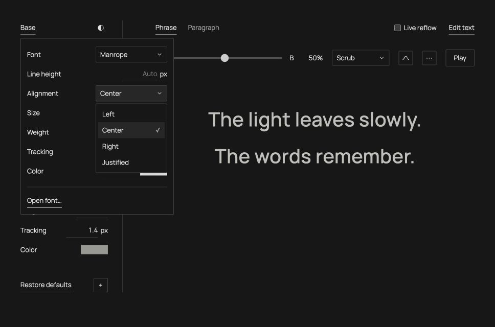
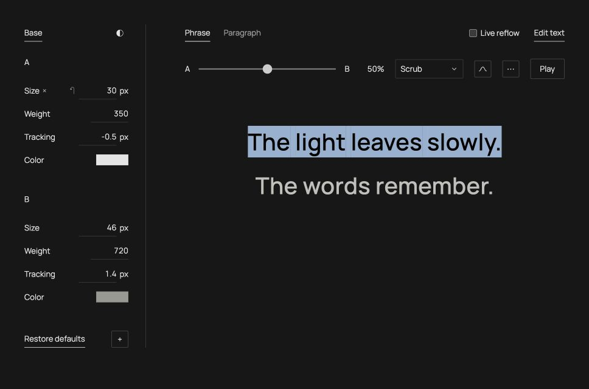

# Between

A small, local web prototype for morphing between two character styles with
[Pretext](https://github.com/chenglou/pretext). Separate from the InDesign script.

Run the app locally, then open **http://127.0.0.1:5173/**.
The web source lives in `web-prototype/` beside the InDesign script.

## Run

Use Node 22.12+ or 24+:

From this folder (or `cd web-prototype` from the repository root):

```sh
npm ci
npm run dev
```

`npm test` checks the interpolation and timing math. `npm run build` produces
`dist/`; `npm run preview` serves that production build locally.

## Try it

- **Live reflow:** toggle beside Edit text. On, line breaks and automatic line
  spacing follow the current styles; off, the existing stable line layout returns.
- **◐:** toggle dark mode; the choice is remembered. Default text colors follow
  the theme; custom colors stay as entered.
- **Open font…** in Base loads a local WOFF/WOFF2/TTF/OTF file.
  It becomes the shared font and appears in A/B font choices. Files are retained
  in this browser for refreshes; nothing is uploaded or installed. Different
  families switch at the midpoint; variable weight works when the font supports it.
- **Base:** shared typography and defaults. Choose font, line height and alignment here;
  active property defaults also live here.
- **A / B:** override size, weight, tracking, color or other active fields.
  The small **↶** on a field restores inheritance from Base.
- **+** adds a property to both styles. Optional properties are opacity, vertical
  shift, rotation, skew, width/height scale, and outline width/color. The **×**, shown on row hover or keyboard focus,
  beside a property in either A or B removes it from both styles. Re-adding restores its entered
  values; while absent, it uses Base. **Restore defaults** resets the entire editor.
- **Scrub:** drag the A–B slider to blend all active properties together.
- **Curve:** distribute the chosen curve across the text. The slider controls
  its strength (0 = A throughout, 100% = full curve); Play animates that strength.
- **Play:** animate back and forth. Playback starts only on request.
- **Proximity:** move across the text; nearby words approach B with a Gaussian
  falloff. Focus the text and use arrow keys for the same interaction.
- **Wipe:** use the slider or Play to move A to B through the reading order.
- **Wave:** use the slider to position a traveling pulse, or Play to loop it.
- **Scroll:** scroll over the specimen to scrub the blend. Touch dragging and
  the slider also work. Escape while the specimen is focused returns to Scrub.
- **Press:** hold the specimen, or hold Space while it is focused, to approach B;
  release to return toward A.
- **∿** opens Distribution: Values per, Restart, Scope, Steps and the curve editor.
- **⋯** beside the mode opens only the relevant interaction settings: radius
  or width, cycle duration, playback direction, response in
  milliseconds, easing, reverse travel and A/B inversion. No settings appear on the main canvas.
- **Phrase / Paragraph:** compare 7 words and 97 words. **Edit text** accepts
  a custom sample, including paragraph breaks.
- **Performance test:** open http://127.0.0.1:5173/?test=1 to show the test panel,
  then run the comparisons with default and combined-effect endpoints.
  It compares cached word widths against per-frame Pretext preparation and
  also exercises independent pointer-driven word styles. Keep the tab visible
  and avoid resizing during the test.

## How it works

The bundled Manrope variable font supplies actual weight interpolation. System
sans, serif and mono stacks can also be selected; their available weights and
exact appearance depend on installed fonts. There is no image crossfade or fake
font-size scaling. The renderer changes font size,
weight, letter spacing and color on real HTML text. Transforms position words.

Pretext measures complete words at **65 intermediate type states**. A and B are
exact, as is the midpoint. Size, weight and tracking use the nearest state;
color interpolates continuously. Different endpoint families switch exactly at
the midpoint; family names do not interpolate. The last A-family type sample is
kept until the switch, so its sampling error near that point can be one full
state interval. Outline width uses the same 65 states to
avoid rasterizing a new stroke width on every frame. With the default endpoints, the maximum
sampling error is 0.125 px in size, about 2.9 weight units and 0.015 px in tracking.

With Live reflow off, Pretext's rich-inline box layout allocates words to lines using their maximum
measured widths across those states. This deliberately keeps line membership
fixed while animating. Current word positions are then computed from cached
widths, so words move apart as they grow. Resizing recomputes line allocation;
editing text or type endpoints rebuilds the measurements. Color and opacity edits reuse them. Transform/outline edits reuse
font measurements and recalculate conservative geometry reservations. Width and
height are transforms, not additional variable-font axes. Rotation, skew, shift
and outline are applied to a whole shaped word; its letters remain together.
Numeric edits wait 220 ms before rebuilding. Resize and pointer events do not
read geometry inside the cached render loop.

Pointer influence uses the stable line-envelope positions, avoiding a feedback
loop where a word moves away from the pointer and repeatedly changes its target.

The prototype avoids application-side DOM measurement in its animation loop.
The browser still lays out and paints the text; this is not a promise of
compositor-only animation. The explicit browser validation does read geometry
outside the timed cases to compare Pretext against actual rendered widths.

## Folder structure

```text
index.html                 Minimal demo markup
src/
  main.js                  Controls, gesture lifecycle and one animation loop
  samples.js               Short and long fading text
  engine/
    morph.js               Pure interpolation, sampling and pointer math
    measurements.js        Pretext measurement cache and stable line allocation
    properties.js          Property registry, Base cascade and endpoint overrides
    typography.js          Font stacks and shared/overridden line-height resolution
    settings.js            Versioned settings, validation and Base/override restoration
    interactions.js        Wipe/wave/proximity fields, easing and response
    geometry.js            Transformed bounds and conservative reservations
    alignment.js           Line offsets, word-space justification and aligned anchors
    appearance.js          Shared sampled geometry for fitting and painting
    reflow.js              Stable identities, cached-width fitting and bounded settling
    distribution.js        Grapheme structures, scopes, restarts and curve sampling
  ui/
    renderer.js            DOM word renderer; no geometry reads in cached frames
    styles.css             Minimal, responsive UI
    property-editor.js     Paired rows, Base inheritance, add/remove and reset
    base-editor.js         Shared font, leading and active property defaults
    style-fields.js        Consistent inputs and field validation
    local-fonts.js         FontFace loading and restoring locally saved files
    font-storage.js        IndexedDB font storage, separate from JSON settings
    interaction-editor.js  Mode-specific settings in a small popover
    distribution-editor.js Curve graph, point editing and structural controls
    popover.js             Position menus once on opening
  benchmark/
    runner.js              Timed comparisons and browser correctness checks
public/fonts/              Bundled variable font and its OFL license
tests/                     Dependency-free Node tests for pure behavior
docs/
  RESULTS.md               Measured results and their limits
  benchmarks/              Raw browser reports, including viewport and validation
  preview.jpg              Desktop preview
  narrow-preview.jpg       Narrow viewport preview
```

Dependencies and generated build files stay in ignored `node_modules/` and
`dist/`. `package-lock.json` pins the install. Font assets are served locally;
no CDN, account, backend service or external telemetry is required.

During `npm run dev` only, the benchmark writes its report to
`docs/benchmarks/latest.json` through a localhost-only Vite endpoint. The
production build displays results without that endpoint. The report contains
browser/version, viewport, timings and check results; it does not include custom
text. Named reports in that folder preserve the development test runs.

## Deliberate limits

- Stable, conservative line breaks by default; optional live word wrapping.
  No automatic hyphenation.
- A bundled Latin variable font, three system font stacks and locally retained font files. Word mode keeps
  shaped words; Letter/Character mode measures and renders individual graphemes.
  This changes kerning/ligatures and does not promise complex-script shaping.
- Sampled type states rather than continuous font measurements every frame.
- Ordinary whitespace collapses inside paragraphs; explicit paragraph breaks remain.
- Long unbreakable words can exceed the frame; the demo warns and allows horizontal
  scrolling instead of distorting the type.
- No justified composition, custom font axes, style inheritance, property stacks
  or export features.

The narrow test runs on the same desktop hardware. It is responsive-layout
verification, not a mobile-device performance claim. See [results](docs/RESULTS.md).

The main interface uses a white background and one 13 px UI type style. Titles,
subtitles, captions, footer copy and permanent readiness text are omitted. Only
loading progress or actionable errors appear as status text.

## Optional effects and stable layout

All added properties share the same blend amount for each word. Easing applies
to that amount; response smooths its change over time. Proximity, Wipe and Wave
can share the selected distribution unit and restart groups. Line grouping uses
fixed lines by default, or the current fitted lines with Live reflow enabled. Pointer influence uses stable
envelope centers to avoid feedback from the text moving beneath the pointer.

Transform bounds reserve the whole endpoint range, including intermediate
rotation angles, so words avoid each other as their shape changes. Rotation and
skew can therefore produce more generous line breaks/spacing. Stroke is only
visible after explicitly adding Outline and setting a positive width; removing
Outline clears it. Opacity, color and transforms stay continuous; base font metrics and outline
width use 65 states. Menus support keyboard navigation, Escape and outside-click
dismissal through the browser's native popover behavior.

## Distribution

The ∿ popover keeps structural controls off the main view:

- **Values per:** All, Character, Letter, Word, Sentence, Line or Paragraph.
  Letter uses grapheme clusters and excludes interword spaces from the sample
  count. Character includes internal spaces. Punctuation remains part of the
  word and receives a grapheme sample in both modes. Gaps omitted by Letter
  follow their preceding grapheme's value.
- **Restart:** Never, Word, Sentence, Paragraph or Line. Word reveals
  **Every … words**; 3 repeats a full curve across successive groups of three
  words. A shorter final group also receives the full curve. Groups start at
  the chosen scope, and units crossing restart boundaries are split.
- **Scope:** Text, Paragraph, Sentence, Line or Word. **Which** selects the
  ordinal nonempty structure (1-based). Everything outside it stays at style A.
  An index beyond the available structures targets the final one. Text is the
  whole specimen; there are no separate threaded frames in this prototype.
- **Curves:** Linear, Ease in/out, S-curve, Gaussian, Sine, Triangle or Custom.
  Bell/arch presets expose Peak; Gaussian also exposes Width. Custom supports
  up to 12 draggable points, add/remove/reset, numeric point x/y and keyboard
  arrows (Shift for larger moves). Endpoint x coordinates stay at 0 and 1;
  interior points cannot cross. Smooth interpolation stays bounded.
- **Steps:** 0 samples every unit. A positive count quantizes the input positions
  to that many evenly spaced samples, capped by the group's unit count. A
  one-unit group uses the curve's start, so a bell cannot peak inside it.

Choosing a curve or editing its shape/steps enters Curve mode. Changing units
or restart rules from Scrub also enters Curve, so the distribution is visible.
Wipe and Wave use the selected units and restart groups for their traveling
fields; Proximity uses each unit's stable center. Scrub, Scroll and Press give
one shared interaction amount to the selected scope. Those modes do not apply
an additional spatial curve; choose Curve to see the drawn profile. Interaction
Ease is independent of the spatial curve. All active properties follow the same
amount per unit, including opacity, transforms and outline.

Character mode retains word boundaries for wrapping, but measures unique
individual graphemes at the same 65 type states. Spaces at composed line ends
are omitted. Switching between Letter and Character reuses the same measurements;
switching back to Word restores whole-word shaping. Font metrics rebuild only
when text, type endpoints or this rendering granularity change. Distribution
plans are cached until the layout or structural settings change, so animation
uses cached unit memberships and bounds. Curves can have many points without
remeasuring fonts on each drag.

## Shared Base settings

**Base** sits above A/B and opens a compact popover. Its font and line height
apply to both endpoints immediately unless that endpoint has an explicit
active override. The panel also contains defaults for all active properties.
The initial size, weight, tracking and color differences are explicit A/B
overrides, so they remain a useful morph example.

Add **Font family** or **Line height** through + to expose their A/B override
rows. Both begin inherited. Edit a field to override just that endpoint;
hover/focus its row and use **↶** to return it to Base. Inherited values are
muted. An explicit value stays an override even if it happens to equal Base.
Changing Base later only affects inherited fields. Removing a property uses
Base for both endpoints and retains entered overrides for re-adding it.
**Restore defaults** resets shared defaults and the original four-property example,
along with text, distribution, interactions, slider, live reflow and theme.

Font choices are bundled **Manrope**, **System sans** (Arial/Helvetica),
**Serif** (Georgia/Times) and **Mono** (Courier). Only the bundled font promises
continuous variable weight; static system fonts use their available faces.
A/B family differences switch at exactly 50%, with measured states on both
sides of the switch. Font and type edits rebuild measurements after the normal
220 ms typing delay. Shared or endpoint font selection does not change the UI
font. No external font requests or font uploads are involved.

Line height is in **pixels**. Empty/0 means **Auto**, preserving the previous
conservative spacing for size and transforms. Explicit values are honored,
including tight/overlapping lines. Auto endpoints resolve before interpolation.
Each composed line uses the largest requested advance among its units, then
positions the following line at that distance. The final line retains enough
canvas height for its ink. Line-height edits reuse font widths and recalculate
layout; no new font measurements are needed. Line membership remains stable by default; Live reflow also updates wrapping.
Pointer anchors use reserved positions in stable mode and event-sampled positions
in live mode.

## Open numeric ranges

Style values are no longer constrained to the original demonstration ranges.
Size accepts zero and arbitrary positive fractions (including subpixel values),
with no application maximum. Tracking, shift, rotation and scales accept finite
signed values; negative scales mirror the text. Leading and outline width accept
nonnegative fractions without an application maximum. All style numeric fields
use `step="any"`, including Base, so an entered fraction is not rejected for
missing a spinner increment.

CSS-domain checks remain: size/leading/outline cannot be negative, weight is
1–1000, and opacity is 0–100%. Installed fonts and browsers may impose their own
rendering limits or map requested weights to the faces available. Zero-size
text is allowed. Strongly negative tracking can intentionally collapse advances
and overlap glyphs; a nonnegative box advance is used for line allocation.

Rotation bounds cover all quadrants and multiple turns. Layout envelopes and
outline padding use absolute scale magnitudes, including when a scale crosses
zero. Skew endpoints may use any finite angles within one interval between
vertical poles; a curve crossing 90° + n×180° has unbounded geometry and is
rejected with an explanation. Non-finite layout results are also rejected, with
the last valid preview retained. No silent style-value clamping is added.

Interaction duration, radius, width and scroll range accept any positive finite
value; response accepts any nonnegative finite value. Gaussian width and easing
power are positive without arbitrary ceilings. Bell peaks can reach 0 or 1.
Steps and words per restart remain discrete counts, without the earlier 10000
ceiling. Normalized curve coordinates stay within 0–1; scope indices follow the
actual number of available structures.

## Live reflow

The checkbox beside **Edit text** is off by default. Turning it on fits complete
words using their **current** sampled widths, transformed bounds, outline padding
and gaps. Small text can use fewer lines; growing text moves words onto following
lines. Automatic line spacing follows the largest current style/transform on each
line. Explicit Base/A/B leading still controls the line advance. Paragraph breaks
and blank paragraphs remain in place. Oversized unbreakable words keep horizontal
scrolling instead of being silently scaled or split.

Reflow uses the already cached Pretext width tables. It performs no new font
measurement or application-side DOM geometry reads in the animation loop. The
fitter works on numeric word advances, excludes outgoing line-end spaces, then
repositions the same DOM nodes. Letter/Character mode keeps stable grapheme IDs;
interword spaces hide at line ends and return when their words join a line.
Toggling or changing rendering granularity may remount the nodes; animation does
not. Turning Live reflow off restores the original conservative composition at
the same current blend amount.

Word/sentence/paragraph groups remain tied to their text identities. Line-based
units, line restart and line scope are recalculated from the resulting layout.
Character curves may also need settling because their space samples change at
line ends. At most **six** numeric settling passes run for a frame. If a pattern
cycles or does not settle within that budget, the last sampled assignments are
kept and fitted exactly. They stay latched while any response animation settles,
until amount, pointer, styles or distribution settings change. No forced line
breaks are inserted. This avoids oscillating composition and keeps the preview
usable; in those fallback cases the exact per-line curve is approximate.

For Proximity, moving the pointer samples the current fitted layout. Those
anchors remain fixed while that pointer position's response settles. The next
pointer movement samples again. This avoids a stationary pointer continually
chasing text that its own styling moved to another line. Resize rebuilds layout
and anchor caches using the existing font measurements.

The performance panel also includes live word reflow, live line-restarted curves
and a live letter wave. Full source/prepared font data remains unchanged during
those cases, so their measured costs include fitting and painting, rather than
repeated font preparation.

## Skew spacing

Skew changes ink without increasing word or character advances, like an oblique
font. Stable and live wrapping use unskewed horizontal bounds; rotation, scale,
tracking and outline still contribute to spacing. True painted bounds still
inform automatic line height and rendering checks. Strong or varying skew may
produce intentional ink overlap; overhang is reserved once at each frame edge,
not between every unit.

Positive skew leans the top of the text right; negative skew leans it left,
matching the typographic convention rather than CSS skewX signs.


## Remembering settings

Edits are saved automatically in this browser on the same address/origin. A
refresh restores Base and A/B values, inherited versus explicit fields, added
properties and their retained overrides, applied sample text, all curve points
and distribution settings, mode-specific interaction profiles, slider amount,
live reflow and theme. Playback always opens paused; transient pointer/press
state and open popovers are not restored.

Small versioned JSON settings use localStorage with a 250 ms save debounce;
page hide and visibility changes flush pending numeric edits. Saving is driven
by control changes, not by animation frames. Font files use IndexedDB with
stable IDs and are decoded before text measurements are rebuilt. Files and text
remain local. Browsers can clear this data, and blocking browser storage prevents
persistence; the editor reports a storage failure and remains usable.

**Restore defaults**, below A/B, resets the whole setup to the original light
example and saves that default state immediately. Previously opened fonts remain
in the local font library, but Manrope becomes the selected font again.


## Alignment and dropdowns

Base → **Alignment** controls the specimen as a whole: Left (default), Center,
Right or Justified. Each line aligns using its current measured widths. Justified
expands only interword spaces on wrapped lines; each paragraph's last line stays
left aligned. Single-word or overlong lines retain their natural width. Letter
and Character rendering preserve spacing inside words. Live reflow fits lines
first, then aligns them; pointer anchors follow the same aligned geometry.
Alignment survives refresh and Restore defaults returns it to Left. Changing it
reuses cached font measurements.

The curve button uses a centered SVG. Select buttons use the same borders,
chevrons, spacing and light/dark colors as the app. Popup menus use
[customizable native selects](https://developer.chrome.com/docs/modern-web-guidance/guides/forms/branded-select-styling)
where supported, preserving native keyboard and accessibility behavior. Other
browsers keep the styled button and their native picker as a fallback.




## Text selection

UI labels, buttons, menus and inactive controls cannot join a text selection.
The specimen uses browser-native selection with system highlight colors; real
whitespace joins the positioned runs so dragging and copying retain word spaces
and paragraph breaks. This works in word and character rendering, including live
reflow and justified gaps. Beginning a text selection pauses playback.

Cmd/Ctrl+A outside a text field selects the specimen only. Inside the text editor
or a focused value field, normal field selection and editing remain available.
Press/Scroll gesture modes keep their existing drag behavior.


